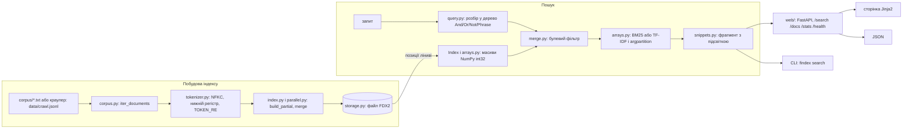

# findex

[](https://github.com/k2s-tempo/findex/actions/workflows/ci.yml)

**findex це пошукова система на Python над діалогами Платона: інвертований індекс, ранжування BM25 і TF-IDF, булеві запити з фразами, CLI, веб-сервіс і сторінка пошуку. Вона зібрана поетапно за вісім лабораторних, і кожне число нижче виміряне, а не оцінене.**

**Живий сервіс: https://findex-hzmi.onrender.com** (версія 1.0.0, Render, безкоштовний тариф: засинає після 15 хв простою, тож перший запит після паузи може тривати до хвилини).


## Три головні числа

| | |
| --- | --- |
| **Корпус** | 23 діалоги Платона (переклад Б. Джоветта, Project Gutenberg), 6 МБ, 21 778 термінів, 82 662 постінги. Для вимірів масштабу той самий корпус ×10: 230 файлів, 62 МБ (це копії, нових слів у них немає) |
| **p95 одного запиту** | 51 мс локально і 404 мс на розгорнутому сервісі (один клієнт; сервіс на безкоштовному Render приблизно в 7 разів повільніший за машину автора) |
| **Найбільше прискорення** | ×78 на ранжуванні списку з 20 000 постінгів: масиви NumPy замість циклу Python. На реальному корпусі це ×7,4-7,8, а сніпети прискорились ×7,3 (352 → 48 мс на запит), завантаження індексу ×3,3 (1,83 → 0,56 с) із пам'яттю в ×5 меншою |

## Спробувати

```
uv sync
uv run findex index corpus -o index.bin
uv run findex search index.bin 'justice AND (courage OR temperance) NOT slave "the soul"'
uv run findex serve --index index.bin        # http://127.0.0.1:8000
uv run pytest -q                              #  тестів, ~20 с
```
Корпус лежить у `corpus/` (тексти Project Gutenberg разом із їхніми ліцензійними шапками). Повний корпус ×10 (`data/`) не в репозиторії.

## Шлях даних



Булевий фільтр визначає, що знайдено, а scorer визначає порядок. Лише терміни поза `NOT` дають внесок у бал.

## Мова запитів

```
python AND (async OR await) NOT java "event loop"
```
`AND`, `OR`, `NOT` лише великими літерами; сусідні операнди означають `AND`; пріоритет `NOT` > `AND` > `OR`; дужки змінюють порядок; фраза в лапках вимагає індексу з позиціями (за замовчуванням `findex index` їх зберігає).

## HTTP API

| Маршрут | Що робить |
| --- | --- |
| `GET /` | сторінка: поле пошуку, сніпети з підсвіткою, бали, перехід між сторінками, перегляд документа (`/d/{id}`) |
| `GET /search?q=&k=&scorer=&page=` | JSON; `q` 1-500 символів, `k` 1-50, `scorer` bm25 або tfidf, `page` 1-100; помилка запиту дає 422 |
| `GET /docs/{doc_id}` | текст документа; невідомий дає 404 |
| `GET /stats`, `GET /health` | кількості в індексі; `/health` дає 503, поки індекс не завантажений |
| `/api/docs` | Swagger (стандартний `/docs` зайнятий) |

Конфіг лише зі змінних оточення: `INDEX_PATH`, `HOST`, `PORT`, `LOG_LEVEL`, `SEARCH_MODE` (sync/async, експеримент), `MAX_CONCURRENT_SEARCHES` (4). Docker і деплой на Render описані в [журналі, лаба 7](docs/lab-log.md).

## Усі вимірювання

Машина: Ryzen 7 5800X (8 ядер), Windows, Python 3.11. Кожен рядок це один прогін або медіана, зазначено в журналі; різниці в межах 5-10% це шум.

### Лаба 1. Генератори й корпус (3 документи, 44 631 токен)

| Версія | Час, с | Пікова пам'ять, МБ |
| --- | --- | --- |
| лінива (генератори) | 0,140 | 1,77 |
| жадібна (списки) | 0,082 | 3,05 |

Пам'ять жадібної версії у 1,7 раза більша; на малому корпусі вона швидша, бо генератор платить за кожен `yield`.

### Лаба 2. Індекс, збереження, пам'ять (23 документи)

| Побудова | Час | Пікова пам'ять |
| --- | --- | --- |
| без позицій | 2,75 с | 27,93 МБ |
| з позиціями | 4,27 с | 62,78 МБ |

| Формат | Файл | Save | Load | Пік пам'яті при load |
| --- | --- | --- | --- | --- |
| pickle | 1,40 МБ | 0,175 с | 0,753 с | 19,38 МБ |
| власний `array` | 0,96 МБ | 0,045 с | 0,405 с | 8,55 МБ |

| Зберігання постінгів | Пам'ять, МБ | Байтів на постінг |
| --- | --- | --- |
| dataclass | 9,56 | 121 |
| dataclass `slots=True` | 6,40 | 81 |
| пари `array('I')` на термін | 5,51 | 70 |
| плоскі `array` + зміщення | 2,79 | 35 |

| Перетин двох списків | merge (два вказівники), мс | set, мс |
| --- | --- | --- |
| 1 000 елементів | 0,187 | 0,043 |
| 100 000 | 19,8 | 13,6 |
| 1 000 000 | 221,9 | 194,4 |

### Лаба 3. Ранжування

| Модель | P@5 (10 розмічених запитів) |
| --- | --- |
| BM25 | 0,70 |
| TF-IDF | 0,58 |

Різниця ~0,1 на 10 запитах статистично не значуща, а без двох найдовших творів (Республіка, Закони) порядок змінюється (0,48 проти 0,56). Кеш запитів: 0,375 → 0,19 мс на повторний запит.

### Лаба 5. Паралельна індексація (корпус 63 МБ, з позиціями)

| Виконавець | Час, с | Прискорення |
| --- | --- | --- |
| serial | 10,84 | 1,00× |
| потоки, 4 | 11,80 | 0,92× |
| потоки, 16 | 12,53 | 0,86× |
| процеси, 4 | 5,95 | 1,82× |
| процеси, 8 | 6,27 | 1,73× |
| процеси, 16 | 6,86 | 1,58× |
| Python 3.13t без GIL, потоки, 8 | 5,62 | 2,06× |
| Python 3.13t з `PYTHON_GIL=1`, потоки, 8 | 12,77 | 0,92× |

### Лаба 6. Асинхронний краулер (200 сторінок)

| Паралельність | Час, с | Сторінок/с |
| --- | --- | --- |
| 1 | 76,06 | 2,63 |
| 5 | 11,80 | 16,94 |
| 20 | 10,23 | 19,55 |

Далі стеля ~20 запитів/с через ввічливу затримку на один хост.

### Лаба 7. Веб-сервіс (`oha`, запит `justice virtue`, k=10, 20 з'єднань)

| Конфігурація | запитів/с | p50 | p95 | p99 |
| --- | --- | --- | --- | --- |
| 1 воркер, `async def` | 23,1 | 880 мс | 1040 мс | 1718 мс |
| 1 воркер, `def` | 25,2 | 831 мс | 913 мс | 1485 мс |
| 4 воркери, `def` | 81,2 | 222 мс | 404 мс | 458 мс |
| розгорнутий сервіс, v0.7.0 (до NumPy) | 3,2 | 7205 мс | 8718 мс | 12606 мс |
| розгорнутий сервіс, v1.0.0 | 3,3 | 7 000 мс | 7 925 мс | 13 197 мс |

Один клієнт (v1.0.0): локально p50 47 / p95 51 / p99 52 мс, на сервісі p50 304 / p95 404 / p99 692 мс.

`/health` під навантаженням (20 з'єднань на `/search`, перевірка в одне з'єднання, 8 с): при `async def` 6 відповідей, p50 1223 мс; при `def` 28 відповідей, p50 258 мс. Пул потоків не додає пропускної здатності (GIL), але лишає цикл подій вільним. Кожен запит потребує ~44 мс роботи інтерпретатора, тож стеля одного процесу ≈ 23-25 запитів/с, а p50 збігається із законом Литтла (20 / 23 ≈ 0,87 с).

### Лаба 8. Профілювання і прискорення

Три найдорожчі місця за cProfile до правок (повністю: [docs/profile.md](docs/profile.md), flame graph: [індексація](docs/flame-index.svg), [пошук](docs/flame-search.svg)):

| Сценарій | Три найдорожчі місця | Що зробили |
| --- | --- | --- |
| індексація `data/big` | цикл `build_partial` 30%, `tokenize` ≈ 32%, `save_array` 15% | нічого: гіпотези записані, але не перевірені правкою |
| ранжування (0,5 мс) | `scoring.score` ~40%, `rank` + `nlargest` ~38%, `merge_and` ~20% | `score` і `rank` переписані на NumPy; `merge_and` лишився |
| запит на сторінці | сніпети: 352 мс із 352,6 мс; 89% цього `find_matches` (прохід `TOKEN_RE` по мільйонах токенів) | `str.find` із перевіркою меж токена: 48 мс |
| завантаження `index_big.bin` | `tolist` позицій 0,84 с + створення `Posting` 1,13 с | позиції ліниві (байти буфера файлу) |

Ранжування, NumPy проти циклу Python з лаби 3 (`scripts/bench_rank.py`, BM25, k=10, кращий із 7 серій):

| Запит | Постінгів | Python, мс | NumPy, мс | Прискорення |
| --- | --- | --- | --- | --- |
| частий терм | 230 | 0,316 | 0,040 | 7,8× |
| рідкісний терм | 10 | 0,019 | 0,026 | 0,7× |
| три терми `justice virtue courage` | 570 | 0,550 | 0,074 | 7,4× |
| синтетичний, 20 000 док., `common` | 20 000 | 26,861 | 0,344 | 78,0× |
| синтетичний, 200 000 док., `common` | 200 000 | 278,274 | 6,666 | 41,7× |

Виграш малий (і навіть від'ємний), де список короткий: на 10 постінгах NumPy платить фіксовану ціну близько 15 викликів по кілька мікросекунд, а цикл Python робить 10 викликів `score`. Порядок результатів збігається з лабою 3: це тест `tests/test_arrays.py` (випадкові індекси, корпус, крайні випадки, нульові довжини).

| Завантаження індексу | до | після | прискорення |
| --- | --- | --- | --- |
| `index_big.bin`: час | 1,83 с | 0,56 с | ×3,3 |
| `index_big.bin`: RSS | +542 МБ | +106 МБ | ×5,1 |
| `findex search index_big.bin ...` повністю (медіана 5 запусків) | 2,42 с (один запуск) | 1,34 с | ×1,8 |

Деталі, баги й гонку в `LazyPositions`: [docs/optimization.md](docs/optimization.md).

## Обмеження

- **Маленький корпус.** 23 тексти, одна мова, один перекладач. «Великий» корпус ×10 це копії, тож у ньому нових слів немає: він ілюструє зростання списків, а не словника. P@5 на 10 запитах не дозволяє статистичних висновків.
- **Семантичного пошуку немає.** Він потребує моделі (~90 МБ) і не вміщується в 512 МБ безкоштовного Render без окремої підготовки; у лабі 8 цей пункт не виконано.
- **Індексація не прискорена.** Гіпотези про цикл і токенізатор записані в `docs/profile.md`, але не перевірені правкою.
- **Булева частина лишилась на Python.** `merge_and`, `Term.evaluate` і особливо `Phrase.evaluate` (фраза з частим словом на корпусі ×10 коштує десятки мілісекунд).
- **Масиви NumPy будуються з Python-списків** при першому зверненні, тож обидва представлення живуть у пам'яті; завантаження постінгів (`Posting`) досі створює об'єкти.
- **Розгорнутий сервіс слабкий.** Безкоштовний Render: засинає, CPU приблизно у 7 разів повільніший, 512 МБ. Перший замір на v0.7.0 вичерпав пам'ять інстанса й дав 377 відповідей 502 (`bench/web-deployed-c20-502.txt`); обмеження `MAX_CONCURRENT_SEARCHES` допомогло, але механізм падіння доведено не повністю.
- **Docker не запускався на машині автора.** Образ перевірено збіркою на Render, а також локально `uv sync --locked --no-dev --no-editable` у чистому середовищі.
- **`def` проти `async def`:** у пропускній здатності різниця в межах шуму (порядок змінився між двома серіями), значущий лише ефект на `/health`.
- **Scalene на Windows не дав корисного результату** (83% часу в `threading.py`), тож «Python чи нативний код» оцінено за cProfile й експериментом.
- **Токенізатор** ділить слова з типографським апострофом (U+2019); корпус Gutenberg використовує прямий.
- **Покриття 93%** (прогалини в краулері лаби 6); нові модулі `web/`, `arrays.py`, `lazy_positions.py` покриті повністю або майже.

## Лабораторні за порядком

| Лаба | Тег | Тема | Де деталі |
| --- | --- | --- | --- |
| 1 | `lab-01` | ітератори, генератори, збір корпусу | [журнал](docs/lab-log.md) |
| 2 | `lab-02` | інвертований індекс, хешування, пам'ять | [журнал](docs/lab-log.md) |
| 3 | `lab-03` | BM25 і TF-IDF, dunder-методи, протоколи, декоратори | [журнал](docs/lab-log.md) |
| 4 | `lab-04` | типи, тести, пакування, CLI | [журнал](docs/lab-log.md) |
| 5 | `lab-05` | GIL, потоки, процеси, паралельна індексація | [журнал](docs/lab-log.md) |
| 6 | `lab-06` | асинхронний краулер | [журнал](docs/lab-log.md) |
| 7 | `lab-07` | FastAPI, Pydantic, Docker, Render | [журнал](docs/lab-log.md) |
| 8 | `lab-08`, `v1.0.0` | профілювання, NumPy, ліниві позиції, README | [profile](docs/profile.md), [optimization](docs/optimization.md) |

## Для розробника

```
uv run ruff check src tests && uv run ruff format --check src tests
uv run pyright                                     # strict
uv run pytest -q                                   # без вимірювань
uv run pytest tests/test_benchmarks.py --benchmark-enable --benchmark-only   # pytest-benchmark, іде в CI
uv run python scripts/bench_rank.py index_big.bin  # таблиця NumPy проти циклу
```
