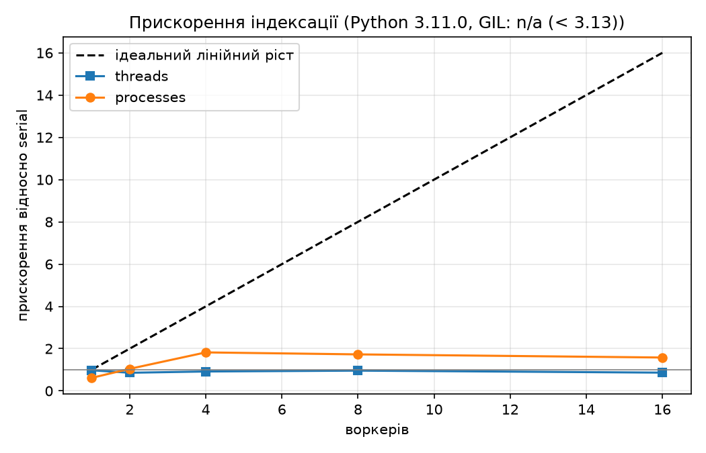
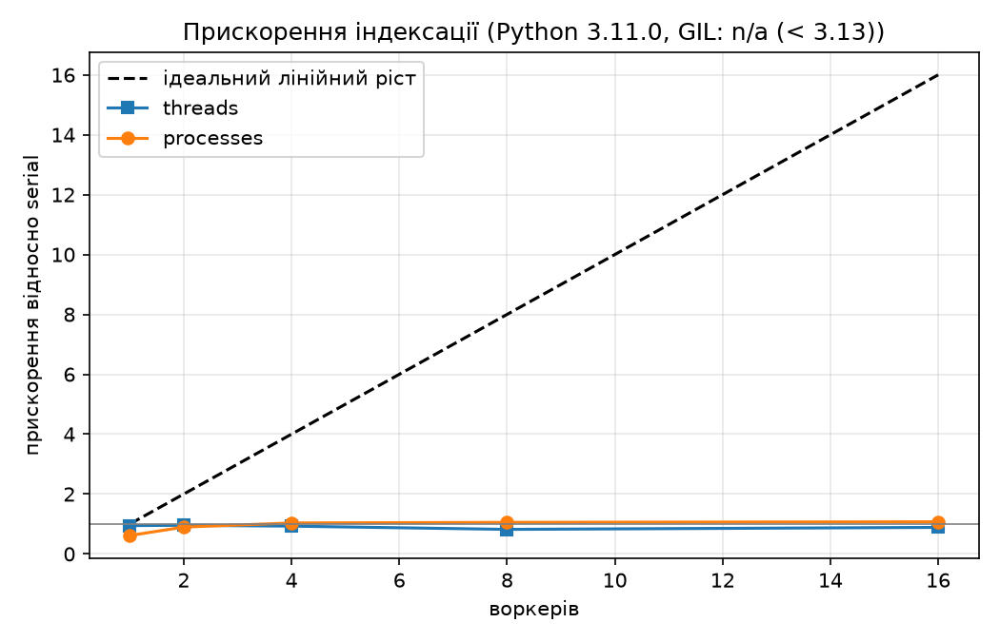

# findex

Навчальний проєкт: власна пошукова система на Python, яка будується поступово протягом курсу.
Лабораторна 1 — ітератори, генератори та збір корпусу.

## Корпус

Джерело: [Project Gutenberg](https://www.gutenberg.org).
На лабораторній 1 корпус складається з 3 діалогів Платона (переклад Бенджаміна Джоветта):

- pg1580.txt — Charmides
- pg1656_apology.txt — Apology
- pg1657_crito.txt — Crito

Формат: .txt (plain text UTF-8). Кожен файл — окремий документ.
До кінця семестру планується розширити корпус до ~1000 документів / ~50 МБ за рахунок інших діалогів і творів з Gutenberg.

data/ не включена в репозиторій (див. .gitignore) — файли корпусу треба завантажити окремо (посилання вище).

## Структура проєкту

    findex/
      src/findex/
        corpus.py         # iter_documents - генератор читання документів
        tokenizer.py      # tokenize - потоковий токенізатор
        stats.py           # лінива (генераторна) статистика корпусу
        stats_greedy.py    # жадібна версія для порівняння
      tests/
        test_tokenizer.py  # тести правил токенізації
      data/raw/             # корпус (у .gitignore)

## Правила токенізації

Реалізовано і задокументовано у tokenizer.py, покрито тестами у tests/test_tokenizer.py:

1. Unicode-нормалізація: NFKC — приводить типографські варіанти символів до єдиної форми.
2. Регістр: усе приводиться до нижнього регістру.
3. Апострофи: апостроф усередині слова (don't, o'brien's) — частина токена; апостроф на межі слова (лапки навколо репліки) — відкидається.
4. Дефіси: дефіс усередині слова (self-driving) — токен лишається одним цілим.
5. Цифри: числа — окремі токени, не змішуються з літерами в одному токені.
6. Уся інша пунктуація відкидається.

## Статистика корпусу (поточний зріз, 3 документи)

| Метрика | Значення |
|---|---|
| Документів | 3 |
| Токенів | 44 631 |
| Розмір словника (унікальні токени) | 4 456 |

Топ-5 найчастіших термів: the (2600), of (1875), and (1747), to (1371), i (936).

## Порівняння: лінива (генераторна) vs жадібна версія

Вимірювання через time.perf_counter() та tracemalloc, той самий корпус (3 файли, 44 631 токен):

| Версія | Час (с) | Пікова пам'ять (КБ) | Пікова пам'ять (МБ) |
|---|---|---|---|
| Лінива (генератори) | 0.1397 | 1 811.5 | 1.769 |
| Жадібна (списки) | 0.0822 | 3 123.9 | 3.051 |

Пікова пам'ять жадібної версії у ~1.7 раза більша, попри те що обидві версії обробляють один і той самий корпус і дають ідентичний результат (44 631 токен, словник 4 456 слів).

### Куди пішла пам'ять у жадібній версії

Жадібна версія (stats_greedy.py) на кожному кроці будує додаткову повну копію даних у пам'яті, замість того щоб обробляти дані по частинах:

1. read_all_documents_greedy() спочатку читає всі файли корпусу і тримає їх повний текст у списку texts, перш ніж почати обробку хоча б одного документа. Весь корпус лежить у RAM одночасно.
2. tokenize_greedy() для кожного документа одразу будує повний список його токенів (findall замість finditer), а не видає токени по одному.
3. compute_stats_greedy() додатково збирає список усіх токенів усього корпусу (all_tokens) в одну плоску структуру — ще одна повна копія даних, яка взагалі не потрібна для підрахунку частот (Counter можна наповнювати "на льоту", без проміжного списку).

Лінива версія (stats.py) уникає всіх трьох копій: iter_documents() віддає по одному документу, tokenize() віддає по одному токену, і єдина структура, що росте, — сам Counter (це результат задачі, а не побічна копія вхідних даних).

На корпусі з 3 невеликих файлів різниця вже помітна (~1.3 МБ додаткової пам'яті). На корпусі з ~1000 документів різниця в жадібній версії зросла б пропорційно до розміру всього корпусу, тоді як лінива версія залишалась би приблизно на одному рівні пікової пам'яті незалежно від розміру корпусу — саме в цьому й полягає перевага генераторів для потокової обробки великих обсягів даних.

Примітка щодо часу виконання: на такому маленькому корпусі жадібна версія показала менший час (0.0822 с проти 0.1397 с) — це очікувано і не суперечить висновку про пам'ять: генератори мають невеликі накладні витрати на кожен виклик yield порівняно з побудовою списку за один прохід (findall), і на малих обсягах ці накладні витрати помітніші за виграш у пам'яті. Перевага генераторів проявляється саме в пам'яті, а не в швидкості, і стає економічно виправданою тоді, коли корпус не вміщується в оперативну пам'ять цілком.

## Запуск

    uv run pytest tests/ -v               # тести токенізатора
    uv run python -m findex.stats         # лінива статистика
    uv run python -m findex.stats_greedy  # жадібна статистика (для порівняння)

---

# Лабораторна 2. Інвертований індекс: словники, хешування та пам'ять

Продовження findex на тому самому корпусі, розширеному до **23 документів** (~6 МБ): діалоги Платона в перекладі Б. Джоветта з Project Gutenberg, plain text UTF-8. Файли лежать у `data/raw/` і не входять до репозиторію (`data/`, `index.bin`, `index.pkl` у `.gitignore`).

## Що реалізовано

| Модуль | Призначення |
|---|---|
| `findex/index.py` | `Posting`, `DocMeta` (`@dataclass(frozen=True, slots=True)`), `Index`, `build_index()`, CLI побудови |
| `findex/search.py` | розбір запиту, Boolean-пошук, рушії `merge` і `set`, CLI пошуку |
| `findex/storage.py` | збереження й завантаження: pickle і власний бінарний формат на `array` |
| `findex/memory_bench.py` | порівняння пам'яті трьох варіантів зберігання постінгів |
| `findex/bench.py` | бенчмарк merge проти set |

Індекс будується одним проходом по лінивому конвеєру з лаби 1 (`iter_documents` → `tokenize`). Структура: `термін → список Posting(doc_id, tf)`, відсортований за `doc_id`. Відсортованість виходить сама: `doc_id` зростає в порядку обходу, окремого `sort()` немає. Постінги збираються через `defaultdict(list)`; після побудови він перетворюється на звичайний `dict`, щоб пошук відсутнього терміна не створював порожній запис. Довжини документів і метадані (ім'я, шлях) лежать у `DocMeta`. Позиції токенів вмикаються прапорцем `--positions` і зберігаються окремо від `Posting`, щоб постінги без позицій не платили за зайве поле.

## Boolean-пошук

Правила запиту: `AND`, `OR`, `NOT` пишуться великими літерами; сусідні терміни означають `AND`; пріоритет `NOT` > `AND` > `OR`; `a NOT b` означає `a AND NOT b`; дужки не підтримуються (тобто `apple OR date NOT banana` читається як `apple OR (date AND NOT banana)`). Терміни запиту нормалізуються тим самим `tokenize()`, що й корпус.

- **merge**: двовказівниковий прохід по відсортованих списках `doc_id`, O(n+m).
- **set**: ті самі операції над множинами Python (`&`, `|`, `-`).
- Вибір рушія: `--engine {merge,set}`. Тести перевіряють, що обидва рушії дають однакові результати.

## Побудова індексу

Корпус: 23 документи, 21 778 термінів, 82 662 постінги.

| Режим | Час побудови | Пікова пам'ять |
|---|---|---|
| без позицій | 2,75 с | 27,93 МБ |
| з позиціями (`--positions`) | 4,27 с | 62,78 МБ |

Позиції коштують **+34,85 МБ (×2,25) і +55% часу**: словник і кількість постінгів однакові, але позицій у ~13 разів більше, ніж постінгів, і кожна це окремий Python-`int` у списку. Вимірювання йшли під `tracemalloc`, який сповільнює виконання, тому абсолютні секунди завищені; для порівняння режимів умови однакові. Пік містить не лише індекс, а й тимчасові копії тексту найбільшого файлу та `Counter`.

## Збереження й завантаження

| Формат | Розмір файлу | Save | Load | Пік пам'яті при load |
|---|---|---|---|---|
| pickle | 1,40 МБ (1 471 814 Б) | 0,175 с | 0,753 с | 19,38 МБ |
| array (власний бінарний) | 0,96 МБ (1 006 416 Б) | 0,045 с | 0,405 с | 8,55 МБ |

Власний формат на 32% менший, зберігає в ~3,9 раза і завантажує в ~1,9 раза швидше. Час save виміряно без `tracemalloc`, час load разом із ним (для load це завищує абсолютне значення, але не порядок). Цифри з одного запуску.

**Формат array**: сигнатура `FDX1`, кількість документів і термінів, блок метаданих документів, далі для кожного терміна: рядок, кількість постінгів, масив `doc_id` і масив `tf` суцільними блоками по 4 байти (`array('I')`, little-endian через `struct`). Формат **не зберігає позиції**; це свідомий компроміс. Pickle зберігає все.

**Безпека pickle.** `pickle.load` небезпечний для чужих файлів: pickle це програма для віртуальної машини pickle, і файл може містити виклик будь-якої функції (через `__reduce__`), яка виконається під час `load()`. Тому завантажуємо лише власні файли (коментар є в `storage.py`). У бінарному форматі код виконати неможливо: ми лише читаємо числа й рядки з перевіркою сигнатури.

**Пастка pickle.** Під `python -m findex.index` модуль має ім'я `__main__`, тож pickle записав би клас як `__main__.Posting`, і інший процес його б не знайшов. Тому `index.py` у блоці запуску імпортує `main` з `findex.index`.

## Пам'ять трьох варіантів зберігання постінгів

Ті самі дані (82 662 постінги, 21 778 термінів, з них 9 961 терміни мають єдиний постінг); міряється утримуваний обсяг через `tracemalloc` (приріст `current` після побудови структури).

| Варіант | Пам'ять, МБ | Байт на постінг | Відносно dataclass |
|---|---|---|---|
| dataclass (без slots) | 9,56 | 121,3 | 1× |
| dataclass `slots=True` | 6,40 | 81,2 | −33% |
| пари `array('I')` на термін | 5,51 | 69,9 | −42% |
| бонус: плоскі `array` + зміщення | 2,79 | 35,4 | −71% |

Розміри окремих об'єктів (`sys.getsizeof`, Python 3.11): екземпляр звичайного dataclass 56 Б, екземпляр зі slots 48 Б, `array('I')` з одним елементом 84 Б, список з одним елементом 64 Б, `int` більший за 256 займає 28 Б.

**Куди пішли байти.** Корисні дані одного постінга, `doc_id` і `tf`, займають 8 байтів (два `uint32`), тобто ~0,66 МБ на весь індекс. Звичайний dataclass витрачає 121 Б, у ~15 разів більше: кожен постінг це окремий об'єкт Python із заголовком, лічильником посилань і службовими полями, до якого додається 8-байтовий вказівник у списку терміна, окремі об'єкти `int` для значень більше 256 (малі числа Python кешує) та накладні витрати на кожен список і запис словника. Без slots екземпляр ще й тримає сховище атрибутів; `slots=True` замінює його двома фіксованими слотами, що дає −40 Б на постінг (−33%). Пари `array('I')` прибирають окремі об'єкти й зберігають значення по 4 байти, але кожен `array` має власні накладні витрати (~80 Б), а ми створюємо два масиви й кортеж на кожен термін, ≈220 Б на термін, що разом ≈4,6 МБ із 5,5 МБ. Це видно на термінах з єдиним постінгом (46% словника): для них пара масивів (≈224 Б) гірша за один об'єкт у списку. Загалом `array` усе одно виграє, бо більшість постінгів лежить у довгих списках. Бонусний варіант (усі постінги в двох великих масивах + `(початок, довжина)` на термін) прибирає накладні витрати масивів і наближається до теоретичного мінімуму; залишок ≈2,1 МБ це облік по термінах (словник, кортежі зміщень, `int`). Рядки-терміни спільні для всіх варіантів і в різницю не входять.

## Бенчмарк merge проти set

**Реальні терміни.** Два найчастіші (`the`, `of`, df=23) і два найрідкісніші (`04`, `104`, df=1; це числові токени); 2000 повторень, найкращий з 7 серій:

| Запит | Знайдено | merge, мкс | set, мкс |
|---|---|---|---|
| the AND of | 23 | 4,37 | 3,21 |
| the OR of | 23 | 4,20 | 3,10 |
| the AND 04 | 1 | 2,71 | 1,79 |
| 04 OR 104 | 2 | 1,20 | 1,12 |
| 04 AND 104 | 0 | 0,94 | 1,07 |
| the NOT 04 | 22 | 7,25 | 3,39 |

**Синтетичні відсортовані списки** (AND двох списків однакового розміру; у корпусі з 23 документів списки завжди ≤23 елементи, тому масштабування видно лише тут):

| Розмір списку | merge, мс | set, мс | set швидший у |
|---|---|---|---|
| 1 000 | 0,187 | 0,043 | 4,3× |
| 100 000 | 19,8 | 13,6 | 1,45× |
| 1 000 000 | 221,9 | 194,4 | 1,14× |

**Висновок.** Обидва алгоритми лінійні, O(n+m), різниця в константі. Merge написаний на чистому Python (кожен крок циклу інтерпретується), а `&`, `|`, `-` над множинами виконує код на C, тому `set` швидший майже всюди. Розрив зменшується зі зростанням списків: на великих списках `set` платить за побудову хеш-таблиці (виділення пам'яті, хешування, промахи кешу), а merge йде послідовно по пам'яті. Єдиний виняток `04 AND 104`: по одному елементу, різниця в межах шуму. Merge при цьому не потребує пам'яті під хеш-таблицю, працює з відсортованими списками й `array` напряму, видає результат потоково, а також може пропускати відрізки (skip-покажчики, бінарний пошук), чого `set` не вміє; наш merge поки лінійний, тому цієї переваги не показано. Set-рушій щоразу будує множини з постінгів: якби індекс тримав їх як множини, швидкість зросла б, але пам'яті пішло б значно більше.

## Запуск

    uv run pytest -q                                                      # тести
    uv run python -m findex.index data/ --out index.bin                  # побудова + збереження (array)
    uv run python -m findex.index data/ --out index.pkl --format pickle  # pickle
    uv run python -m findex.index data/ --positions                      # ціна позицій
    uv run python -m findex.search index.bin "socrates virtue"           # пошук зі збереженого індексу
    uv run python -m findex.search index.bin "justice OR courage NOT virtue" --engine set
    uv run python -m findex.memory_bench data/                           # таблиця пам'яті
    uv run python -m findex.bench index.bin                              # бенчмарк merge vs set

Обидва CLI (`findex.index`, `findex.search`) друкують час і пікову пам'ять.

---

# Лабораторна 3. Рейтинг і модель об'єктів: dunder-методи, протоколи, декоратори

Продовження findex на тому самому корпусі (23 діалоги Платона в перекладі Джоветта, середня довжина документа ~46 389 токенів). Індекс став об'єктом «як у Python», а Boolean-пошук ранжованим списком зі сніпетами.

## Що реалізовано

| Модуль | Призначення |
|---|---|
| `findex/index.py` | клас `Index(Mapping)`: `len`, `in`, `index[term]`, ітерація, `repr`, `df`, `num_docs`, `avg_doc_length` (`cached_property`), `close()` |
| `findex/storage.py` | бінарний формат `FDX2` (з позиціями, `FDX1` теж читається), `open_index()` як context manager |
| `findex/scoring.py` | протокол `Scorer`, класи `TfIdf` і `BM25(k1=1.5, b=0.75)` |
| `findex/ranking.py` | `SearchResult` (`order=True`), `rank()` на `heapq.nlargest` |
| `findex/query.py` | вузли `Term/Phrase/And/Or/Not`, лексер, рекурсивний спуск, `ranked_search`, CLI |
| `findex/decorators.py` | `@timed` (замикання + `functools.wraps`) |
| `findex/cache.py` | `lru_cache` на відображення «дерево запиту -> id документів» |
| `findex/snippets.py` | сніпети з підсвіткою |
| `findex/sanity.py`, `findex/evaluation.py` | три sanity-check; P@5 для TF-IDF і BM25 |

Тестів: 170 (`uv run pytest -q`).

## Index як об'єкт Python

`Index` наслідує `collections.abc.Mapping`: реалізовано лише `__getitem__`, `__iter__`, `__len__`, а `keys()`, `items()`, `get()`, `==` приходять від базового класу. `__contains__` перевизначено для швидкості, `__repr__` показує кількість документів, термінів і наявність позицій. `num_docs` це `property`, `avg_doc_length` це `functools.cached_property`: значення рахується один раз і лежить у `__dict__` екземпляра, тому `Index` не може бути `slots`-класом (на відміну від `Posting` і `DocMeta`). `df(term)` дає document frequency.

`open_index(path)` це `@contextmanager`: завантажує індекс, віддає його, а у `finally` викликає `index.close()`. Закриття відбувається і при винятку всередині `with`: очищує дані індексу й виконує зареєстровані `on_close`-дії (так очищується кеш запитів). Після закриття звернення до індексу піднімає `ValueError`.

## Позиції токенів у збереженому файлі (FDX2)

Для фраз потрібні позиції, а бінарний формат лаби 2 їх не зберігав. У `FDX2` після `doc_ids` і `tfs` кожного терміна йде один суцільний блок позицій; скільки їх у кожного постінга, відомо з його `tf`, тому окремі лічильники не потрібні. Старі файли `FDX1` читаються далі.

| Індекс | Файл | Load (під tracemalloc) | Пік пам'яті при load |
|---|---|---|---|
| без позицій (лаба 2) | 0,96 МБ | 0,41 с | 8,55 МБ |
| з позиціями (`FDX2`) | 5,03 МБ | 2,33 с | 59,80 МБ |

Позиції збільшують файл у ~5 разів, бо кожну позицію після читання треба перетворити на окремий Python-`int` у списку. Побудова з позиціями: 4,40 с, пік 62,78 МБ, збереження 0,23 с. Без `tracemalloc` той самий `load` займає 174 мс (за логом `@timed`), тобто `tracemalloc` сповільнює завантаження приблизно в 13 разів.

## Scorer: TF-IDF і BM25

`Scorer` це `typing.Protocol` з одним методом `score(tf, df, doc_len, index)`. `TfIdf` і `BM25` не наслідують спільний клас, достатньо мати метод (duck typing), тож їх можна міняти місцями.

    TF-IDF:  (1 + ln tf) * ln(1 + N/df) / sqrt(doc_len / avg_len)
    BM25:    idf * tf*(k1+1) / (tf + k1*(1 - b + b*doc_len/avg_len)),
             idf = ln(1 + (N - df + 0.5) / (df + 0.5)),  k1 = 1.5, b = 0.75

`TfIdf(norm=False)` дає класичний варіант без урахування довжини. `search` накопичує бали по документах і бере топ-k через `heapq.nlargest`; за однакового балу першим іде документ із меншим `doc_id`. `SearchResult` це `@dataclass(frozen=True, order=True)`, порівнюється лише за полем `score` (решта полів `compare=False`).

## Три sanity-check рейтингу (на корпусі, `python -m findex.sanity index.bin`)

**1. Рідкий термін вище частого** (tf=1, документ середньої довжини):

| Термін | df | TF-IDF | TF-IDF без норм. довжини | BM25 |
|---|---|---|---|---|
| `abandon` | 1 | 3.178 | 3.178 | 2.773 |
| `the` | 23 | 0.693 | 0.693 | 0.021 |

Запит `the abandon`: перший за BM25 Timaeus, єдиний документ із `abandon`. BM25 майже обнуляє слово, що є в усіх документах (`idf = ln(1 + 0.5/23.5) ~ 0.021`); TF-IDF із нашим згладженням лишає йому `ln 2 = 0.693`.

**2. 20-те повторення майже нічого не додає** (df=3):

| tf | TF-IDF | TF-IDF без норм. довжини | BM25 |
|---|---|---|---|
| 1 | 2.159 | 2.159 | 1.925 |
| 2 | 3.656 | 3.656 | 2.750 |
| 5 | 5.635 | 5.635 | 3.702 |
| 10 | 7.132 | 7.132 | 4.185 |
| 20 | 8.629 | 8.629 | 4.477 |
| 50 | 10.607 | 10.607 | 4.673 |
| 100 | 12.104 | 12.104 | 4.742 |

| Внесок одного повтору | TF-IDF | BM25 |
|---|---|---|
| 1 -> 2 | 1.4968 | 0.8251 |
| 19 -> 20 | 0.1108 | 0.0164 |

Двадцяте входження додає 7% від внеску другого за TF-IDF і 2% за BM25. BM25 має стелю `idf*(k1+1)`, TF-IDF росте логарифмічно без межі. Стовпці TF-IDF з нормалізацією й без збігаються, бо тут довжина документа дорівнює середній (множник нормалізації 1).

**3. Короткий документ з одним входженням вище довгого.** Термін `andromache` (df=2) зустрічається по одному разу в Ion (6 551 токен) і в Republic (255 463 токени):

| Scorer | Ion | Republic | Короткий вище? |
|---|---|---|---|
| TF-IDF | 6.721 | 1.076 | так |
| TF-IDF без норм. довжини | 2.526 | 2.526 | ні (рівні) |
| BM25 | 3.686 | 0.747 | так |

Відношення 6,25 у TF-IDF це якраз `sqrt(255 463 / 6 551)`. Класичний TF-IDF довжини не бачить зовсім.

## Мова запитів

    python AND (async OR await) NOT java "event loop"

Граматика (рекурсивний спуск, кожне правило це метод парсера):

    or_expr  := and_expr ( OR and_expr )*
    and_expr := not_expr ( [AND] not_expr )*
    not_expr := NOT not_expr | atom
    atom     := TERM | PHRASE | "(" or_expr ")"

Правила: `AND`, `OR`, `NOT` пишуться лише великими літерами (малі `and`, `or` це звичайні терміни); сусідні операнди без оператора означають `AND`; пріоритет `NOT` > `AND` > `OR`; дужки змінюють порядок; терміни запиту нормалізуються тим самим `tokenize()`, що й корпус. Фраза в лапках вимагає індексу з позиціями (`--positions`); слова мають іти підряд, пунктуація не є токеном, тому `"event, loop"` збігається з `"event loop"`. Фраза з одного слова стає звичайним терміном.

Вузли `Term`, `Phrase`, `And`, `Or`, `Not` це `@dataclass(frozen=True)`: порівнюються за значенням, хешуються, а базовий клас перевантажує `&`, `|`, `~`, тож `Term("a") & ~Term("b") | Term("c")` будує те саме дерево, що й парсер. Метод `evaluate(index)` повертає відсортований список `doc_id` (злиття списків із лаби 2; `Phrase` перевіряє, що позиція наступного слова дорівнює позиції попереднього плюс один). Тести парсера порівнюють дерева, а не рядки.

Boolean-фільтр визначає, що знайдено; scorer визначає порядок. Бал додають лише терміни поза `NOT`; для запиту лише з `NOT` документи повертаються з балом 0.

## @timed і кеш запитів

`@timed` (замикання з `functools.wraps`) пише в лог час виклику й накладений на `build_index`, `load`, `ranked_search`; час логується і при винятку (`finally`). Кеш `lru_cache` зберігає відображення «дерево запиту -> кортеж id». Ключем є саме дерево, а не рядок: вузли frozen, тож запити `justice AND virtue` і `JUSTICE   virtue` дають рівні дерева й один запис. Значення це кортеж (а не список), бо `lru_cache` повертає той самий об'єкт. Кеш очищується при `index.close()`.

    > uv run python -m findex.query index.bin "justice AND virtue" "JUSTICE   virtue" "justice OR courage" "justice AND virtue" -k 3
      [лог] timed: load 174.363 мс
    > justice AND virtue
      [лог] cache MISS: (justice AND virtue)
      [лог] timed: ranked_search 0.375 мс
    > JUSTICE   virtue
      [лог] cache HIT:  (justice AND virtue)
      [лог] timed: ranked_search 0.228 мс
    > justice OR courage
      [лог] cache MISS: (justice OR courage)
      [лог] timed: ranked_search 0.229 мс
    > justice AND virtue
      [лог] cache HIT:  (justice AND virtue)
      [лог] timed: ranked_search 0.187 мс
    Кеш: CacheInfo(hits=2, misses=2, maxsize=128, currsize=2)

Виграш від кешу невеликий (0,375 -> 0,19 мс): він економить лише обчислення дерева (злиття списків), а ранжування рахується заново; на 23 документах це мікросекунди.

## Сніпети

Для кожного результату читається файл документа, шапка Gutenberg відрізається тим самим `_strip_boilerplate`, що й при індексації, межі токенів беруться з регулярного виразу токенізатора. «Найкраще входження» це те, навколо якого (+-80 символів) найбільша сума `idf` різних термінів запиту (так рідкі слова переважують стоп-слова), далі більше входжень, далі раніше в тексті; вибір робиться за один прохід двома вказівниками. Межі вікна зсуваються до пробілів, терміни підсвічуються як `**слово**`.

    3.   0.425  meno  (22246 токенів)
         ...'**Virtue** is the power of getting good with **justice**.' But **justice** is a part of **virtue**, and therefore **virtue** is the getting of good with a part of **virtue**. The...

Обмеження: слова фрази підсвічуються окремо; шлях до файлу береться з `DocMeta.path` (відносний), тому сніпети працюють, якщо запускати з кореня проєкту.

## Якість: precision@5 (TF-IDF проти BM25)

10 запитів із розміткою «які документи мають бути в топ-5» (розмітка складена за змістом діалогів до першого запуску оцінки; запити з sanity-check і демо в розмітку не входять). P@5 = (скільки з топ-5 є в розмітці) / 5. Якщо розмічено менше п'яти документів, максимум менший за 1.

| № | Запит | Розмічено | P@5 BM25 | P@5 TF-IDF |
|---|---|---|---|---|
| 1 | `piety OR holiness` | 4 | 0.60 | 0.40 |
| 2 | `temperance` | 5 | 0.80 | 0.40 |
| 3 | `rhetoric OR orator` | 3 | 0.60 | 0.60 |
| 4 | `poets OR poetry` | 5 | 0.40 | 0.60 |
| 5 | `sophist OR sophists` | 5 | 0.80 | 0.80 |
| 6 | `pleasure` | 5 | 1.00 | 0.60 |
| 7 | `wealth OR riches` | 4 | 0.60 | 0.20 |
| 8 | `creation OR universe OR cosmos` | 5 | 0.60 | 0.80 |
| 9 | `falsehood OR lie OR lies` | 5 | 0.60 | 0.40 |
| 10 | `prison OR indictment OR trial` | 5 | 1.00 | 1.00 |
| | **Середнє** | | **0.70** | **0.58** |

BM25 виграв у 5 запитах, TF-IDF у 2, у 3 нічия. Повні топ-5 за кожним запитом друкує `uv run python -m findex.evaluation index.bin` (влучання позначені знаком галочки).

**Застереження.** (1) Перевага BM25 значною мірою пояснюється двома найдовшими творами: Republic і Laws (~250 тис. токенів кожен) розмічені як релевантні майже скрізь, і в топ-5 BM25 вони потрапляють 11 разів, а в топ-5 TF-IDF лише 1 раз, бо нормалізація `sqrt(довжина/середня)` штрафує довгі документи сильніше, ніж BM25 із `b = 0.75`. Якщо прибрати Republic і Laws із розмітки, середнє стає 0.48 для BM25 і 0.56 для TF-IDF, тобто порядок змінюється. (2) Різниця ~0.1 на 10 запитах (приблизно 6 влучань на 50 позицій) статистично не значуща. (3) Документ поза розміткою не обов'язково нерелевантний: розмітка складена за назвою й загальним змістом діалогу, а не за читанням кожного уривка, тому P@5 занижує обидва scorer-и. Висновок: на цій розмітці BM25 кращий, але його перевага залежить від того, чи вважати довгі твори релевантними.

## Запуск

    uv run pytest -q
    uv run python -m findex.index data/ --positions --out index.bin
    uv run python -m findex.query index.bin "justice AND (courage OR temperance) NOT slave \"the soul\"" "JUSTICE   courage"
    uv run python -m findex.ranking index.bin "justice virtue" --scorer tfidf
    uv run python -m findex.sanity index.bin
    uv run python -m findex.evaluation index.bin

Індекс для фраз треба будувати з `--positions` (у cmd лапки фрази екрануються як `\"`).

# Лабораторна 4. Типи, тести, пакування і CLI

## Встановлення і команди

    uv tool install .                  # кладе команду findex у PATH
    findex --help
    findex index data/raw -o index.bin
    findex search index.bin "virtue NOT crito" --engine set
    findex search index.bin "virtue" --json > result.json
    findex stats index.bin -n 10
    findex -vv search index.bin "virtue"   # -v / -vv: більше логів, у stderr

Очікувані помилки (немає файлу, зламаний запит) дають один рядок у stderr і ненульовий код виходу, без стека викликів.

## Тести, типи, покриття

    uv run pytest                      # усі тести (253)
    uv run pytest -m "not slow"        # без повільних
    uv run pytest --cov=findex --cov-report=term-missing
    uv run pyright                     # strict, 0 помилок
    uv run ruff check src tests

**Покриття: 100%** (рядки і гілки: 898 операторів, 200 гілок), Python 3.11.
У `src/findex` жодного `# type: ignore`. CI (ruff, pyright, pytest) йде на Python 3.11 і 3.12.

Що саме означає це число і чого воно не гарантує:

- Міряється лише пакет `src/findex`. Каталог `scripts/` (бенчмарки, оцінка якості) у покриття не входить.
- З підрахунку виключено за налаштуванням `pyproject.toml`: блоки `if __name__ == "__main__":`, рядки `raise NotImplementedError` і рядки з одним `...` (заглушки протоколів).
- Гілки `BIG_ENDIAN` у `storage.py` покриті тестом із підміненим прапорцем: він перевіряє, що `byteswap` при записі й читанні взаємно обернені, але на справжній big-endian машині код не запускався.
- Вивід `rich` (таблиці, смуга прогресу) перевіряється за ключовими підрядками, а не за повним виглядом.
- Відомий кордон правил токенізатора: типографський апостроф (U+2019) розбиває `don’t` на `don` і `t`. Корпус Gutenberg використовує прямий апостроф, тож тут це не заважає; поведінку зафіксовано тестом.
- Покриття показує, які рядки виконано, а не чи правильні результати. Для цього є властивісні тести Hypothesis (round-trip `save`/`load`, відсортованість постінгів, збіг `merge_*` з операціями над `set`).

| Executor | Workers | Wall (s, median) | CPU (s) | Peak RSS (MB) | Merge (s) | Speedup |
| --- | --- | --- | --- | --- | --- | --- |
| serial | 1 | 10.84 | 10.73 | 589 | 0.005 | 1.00× |
| threads | 1 | 11.10 | 11.00 | 620 | 0.105 | 0.98× |
| threads | 2 | 12.62 | 12.52 | 637 | 0.155 | 0.86× |
| threads | 4 | 11.80 | 11.80 | 657 | 0.193 | 0.92× |
| threads | 8 | 11.29 | 11.27 | 700 | 0.253 | 0.96× |
| threads | 16 | 12.53 | 12.86 | 749 | 0.345 | 0.86× |
| processes | 1 | 17.56 | 15.38 | 642 | 0.082 | 0.62× |
| processes | 2 | 10.38 | 16.17 | 651 | 0.126 | 1.04× |
| processes | 4 | 5.95 | 15.23 | 667 | 0.186 | 1.82× |
| processes | 8 | 6.27 | 17.69 | 707 | 0.283 | 1.73× |
| processes | 16 | 6.86 | 20.19 | 757 | 0.361 | 1.58× |

# Лабораторна 5. Конкурентність і GIL: потоки, процеси і паралельна індексація

Продовження findex: перехід від однопотокової побудови індексу до паралельної збірки за схемою Map-Reduce (`build_partial` -> `merge`) з підтримкою трьох виконавців (`serial`, `threads`, `processes`) та порівнянням зі збіркою Python 3.13t (free-threaded, без GIL).

## Що реалізовано

Модуль | Призначення
---|---
`findex/index.py` | `PartialIndex`, `build_partial()` (функція рівня модуля, приймає шляхи й стартовий `doc_id`), `merge()` (послідовне склеювання відсортованих постінгів)
`findex/parallel.py` | `plan_chunks()` (балансування шматків за байтами, `CHUNKS_PER_WORKER = 4`), `build_parallel()`, `resolve_executor()`, `ThreadPoolExecutor` та `ProcessPoolExecutor` із `spawn`
`findex/cli.py` | прапорці `--executor {auto,serial,threads,processes}` (`-x`) та `--workers N` (`-w`) для `findex index`
`scripts/bench_parallel.py` | замір wall time, CPU time, Peak RSS, часу `merge` та генерація графіків прискорення у `bench/`

- **Передача шляхів замість тексту:** у воркери через `pickle` передаються лише пари `(start_id, list[Path])`. Кожен воркер сам читає файли з диска, мінімізуючи накладні витрати на серіалізацію.
- **Унікальні `doc_id` наперед:** відсортовані шляхи розбиваються на суцільні шматки за розміром файлів (`plan_chunks`), тому діапазони `doc_id` не перетинаються і при `merge()` не потрібне повторне сортування постінгів.
- **Безпека для `spawn` та обробка збоїв:** `ProcessPoolExecutor` завжди використовує `multiprocessing.get_context("spawn")`. Якщо воркер падає з винятком, `as_completed` одразу прокидає його стек і скасовує решту задач без зависання пулу.
- **Автовибір виконавця (`--executor auto`):** для корпусів до 8 МБ (`AUTO_MIN_BYTES`) старт процесів через `spawn` не окупається, тому `auto` обирає `serial`; для більших корпусів вмикається `processes` (типово до 4 воркерів).

## Бенчмарки побудови індексу

Середовище: AMD Ryzen 7 5800X (8 фізичних ядер / 16 логічних потоків), Windows, Python 3.11.0 та Python 3.13t. Кожна конфігурація запущена щонайменше 3 рази після прогріву; у таблицях наведено медіану.

**Великий корпус (~63 МБ, з позиціями, Python 3.11):**

| Executor | Workers | Wall (s, median) | CPU (s) | Peak RSS (MB) | Merge (s) | Speedup |
| --- | --- | --- | --- | --- | --- | --- |
| serial | 1 | 10.84 | 10.73 | 589 | 0.005 | 1.00× |
| threads | 1 | 11.10 | 11.00 | 620 | 0.105 | 0.98× |
| threads | 2 | 12.62 | 12.52 | 637 | 0.155 | 0.86× |
| threads | 4 | 11.80 | 11.80 | 657 | 0.193 | 0.92× |
| threads | 8 | 11.29 | 11.27 | 700 | 0.253 | 0.96× |
| threads | 16 | 12.53 | 12.86 | 749 | 0.345 | 0.86× |
| processes | 1 | 17.56 | 15.38 | 642 | 0.082 | 0.62× |
| processes | 2 | 10.38 | 16.17 | 651 | 0.126 | 1.04× |
| processes | 4 | 5.95 | 15.23 | 667 | 0.186 | 1.82× |
| processes | 8 | 6.27 | 17.69 | 707 | 0.283 | 1.73× |
| processes | 16 | 6.86 | 20.19 | 757 | 0.361 | 1.58× |

**Базовий корпус (23 документи, ~6 МБ, з позиціями, Python 3.11):**

| Executor | Workers | Wall (s, median) | CPU (s) | Peak RSS (MB) | Merge (s) | Speedup |
| --- | --- | --- | --- | --- | --- | --- |
| serial | 1 | 0.93 | 0.92 | 85 | 0.005 | 1.00× |
| threads | 1 | 0.98 | 0.97 | 94 | 0.024 | 0.95× |
| threads | 2 | 0.97 | 0.98 | 101 | 0.028 | 0.96× |
| threads | 4 | 1.00 | 0.98 | 104 | 0.032 | 0.93× |
| threads | 8 | 1.13 | 1.12 | 106 | 0.047 | 0.82× |
| threads | 16 | 1.05 | 1.03 | 106 | 0.034 | 0.89× |
| processes | 1 | 1.51 | 1.27 | 98 | 0.026 | 0.62× |
| processes | 2 | 1.03 | 1.34 | 103 | 0.044 | 0.90× |
| processes | 4 | 0.90 | 1.55 | 106 | 0.047 | 1.03× |
| processes | 8 | 0.88 | 1.83 | 108 | 0.044 | 1.05× |
| processes | 16 | 0.86 | 1.97 | 108 | 0.042 | 1.07× |

**Free-threaded Python 3.13t (без GIL, `sys._is_gil_enabled() == False`):**

| Executor | Workers | Wall (s, median) | CPU (s) | Peak RSS (MB) | Merge (s) | Speedup |
| --- | --- | --- | --- | --- | --- | --- |
| serial | 1 | 11.57 | 11.44 | n/a | 0.008 | 1.00× |
| threads | 1 | 12.36 | 12.30 | n/a | 0.156 | 0.94× |
| threads | 2 | 9.69 | 15.75 | n/a | 0.199 | 1.19× |
| threads | 4 | 6.39 | 15.08 | n/a | 0.252 | 1.81× |
| threads | 8 | 5.62 | 19.62 | n/a | 0.391 | 2.06× |
| threads | 16 | 5.61 | 29.97 | n/a | 0.464 | 2.06× |

**Та сама збірка з примусово увімкненим GIL (`PYTHON_GIL=1`):**

| Executor | Workers | Wall (s, median) | CPU (s) | Peak RSS (MB) | Merge (s) | Speedup |
| --- | --- | --- | --- | --- | --- | --- |
| serial | 1 | 11.77 | 11.69 | n/a | 0.008 | 1.00× |
| threads | 1 | 12.10 | 12.00 | n/a | 0.146 | 0.97× |
| threads | 2 | 12.52 | 12.30 | n/a | 0.204 | 0.94× |
| threads | 4 | 12.99 | 12.95 | n/a | 0.280 | 0.91× |
| threads | 8 | 12.77 | 12.83 | n/a | 0.370 | 0.92× |
| threads | 16 | 13.22 | 13.14 | n/a | 0.479 | 0.89× |

## Пояснення: GIL, процеси, закон Амдала та Python 3.13t

**Чому потоки під GIL не прискорили індексацію.** Побудова інвертованого індексу — переважно CPU-bound задача: читання `.txt` із кешу ОС займає мілісекунди, а основний час іде на регулярні вирази в `tokenize()` та словники в чистому Python. У стандартному CPython м'ютекс GIL захищає підрахунок посилань (`reference counting`) і дозволяє виконувати байткод лише одному потоку одночасно. Потоки по черзі перехоплювали GIL кожні ~5 мс (`sys.getswitchinterval()`), витрачаючи час на перемикання контексту та промахи кешу, тому працювали повільніше за `serial` (0.82×–0.96×).

**Чому процеси прискорили роботу і чим це оплачено.** `ProcessPoolExecutor` запускає окремі процеси з власним інтерпретатором та власним GIL. ОС розподіляє їх по ядрах Ryzen 7 5800X, що на великому корпусі скоротило `wall time` із 10.84 с до 5.95 с (1.82× на 4 воркерах). Ціна цього прискорення:
- *CPU time проти Wall time:* на 1 процесі `processes` займає 17.56 с (0.62×), а на 4 процесах сумарний `CPU time` становить 15.23 с проти 5.95 с `wall time` через старт інтерпретаторів (`spawn`), імпорт модулів і `pickle`-серіалізацію словників `PartialIndex` із позиціями.
- *Пік пам'яті (Peak RSS):* кожен воркер тримає копію інтерпретатора, а батьківський процес накопичує всі `PartialIndex` до завершення `merge()` (пік зріс із 589 МБ до 667–757 МБ).
- *Малий корпус (~6 МБ):* індексація триває 0.93 с, тому накладні витрати на `spawn` і `pickle` майже з'їдають виграш (1.03×–1.07×). Саме тому поріг `AUTO_MIN_BYTES` встановлено на 8 МБ.

**Закон Амдала.** Максимальне прискорення обмежене послідовною часткою `(1 - p)`: `S_max = 1 / (1 - p)`. Паралельно виконується лише `build_partial()`, тоді як у головному процесі послідовно відбуваються розпакування результатів із `as_completed` (десеріалізація `pickle`) та `merge()` (яке зростає з 0.005 с до 0.186–0.361 с). Через цю послідовну фазу крива прискорення досягає піку на 4 процесах (1.82×) і виходить на плато на 8 та 16 воркерах (1.73× і 1.58×).

**Python 3.13t (без GIL) та гонитва даних.** Після вимкнення GIL (`sys._is_gil_enabled() == False`, PEP 703) потоки у `ThreadPoolExecutor` почали виконувати байткод паралельно на різних ядрах без витрат на `spawn` і `pickle`: на 8–16 воркерах час впав до 5.61–5.62 с (2.06×), випередивши процеси. Водночас без серіалізації через GIL інкремент спільного лічильника (`shared += 1`) без блокування втрачає оновлення через неатомарність байткоду (`LOAD_GLOBAL` -> `BINARY_OP` -> `STORE_GLOBAL`). У `findex` спільний змінний стан між воркерами повністю виключено: кожен потік повертає ізольований `PartialIndex`, а оновлення прогресу (`on_chunk`) іде лише в головному потоці.

## Запуск

    uv run pytest -q
    findex index data/raw --executor processes --workers 4 -o index.bin
    findex index data/raw --executor threads --workers 4 -o index.bin
    findex index data/raw --executor serial -o index.bin
    uv run python scripts/bench_parallel.py
